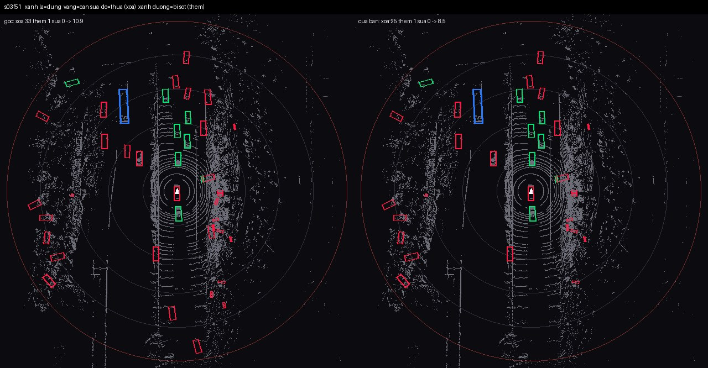

# Báo cáo Day 14 — Trần Quang Nam — 2A202603118

- Mã học viên dùng với `--student`: `118`
- `seed_tag` trong `frames_A.txt`: `393590736f`

## 1. Dự đoán trước sweep (bước 5b)

Ghi **trước** khi chạy `scripts/pp_sweep.py`, rồi commit và push ngay (lịch sử commit là bằng chứng thời điểm viết). Không sửa phần này sau khi có kết quả.

- Tham số tôi nghĩ giảm công sửa nhiều nhất: tổ hợp `score_thr=0.4` + `min_points=5`.
- Vì sao (nhìn ảnh BEV tập A: box thừa nhiều hay box sót nhiều?): Cấu hình gốc trên tập A cần xóa 55, thêm 4, sửa 0 (chi phí 20.5). Riêng phần xóa đã là 0.3 × 55 = 16.5, khoảng 80% chi phí, nên giảm box thừa là cách giảm công sửa nhanh nhất. Trong ảnh png_A, phần lớn box thừa có score thấp (Cyclist trong bụi cây, Car trên hàng rào cây), còn xe thật rõ ràng thường có score cao, nên tăng `score_thr` lên 0.4 sẽ loại được nhiều box thừa nhất. `min_points=5` bổ sung để bỏ các box gần như trống (trên mặt đường trống, ở xa nơi LiDAR thưa) mà vẫn có score khá. Rủi ro: một số xe thật ở xa hoặc bị che có score dưới 0.4 sẽ bị lọc mất, mỗi xe mất tốn 1.0, đắt hơn 3 lần một lần xóa; còn box thừa nằm trong bụi cây mà score cao thì cả hai ngưỡng đều không loại được.

## 2. Tập A: sửa tay và tune

| Cấu hình | Xóa | Thêm | Sửa | Chi phí |
|---|---:|---:|---:|---:|
| Gốc | 55 | 4 | 0 | 20.5 |
| `best_config.json` | 38 | 4 | 0 | 15.4 |

- Công cụ hỗ trợ (khai báo theo RULES): lượt sửa đầu do trợ lý AI (Claude Code) làm bằng script LiDAR + camera: xóa 50, thêm 4 (2 Bus, 1 Car, 1 Cyclist). Tôi kiểm lại trên CVAT và xóa thêm 1 box.
- Tham số đã đổi trong `best_config.json`: `score_thr` 0.1 → 0.3, `min_points` 0 → 5 (các tham số khác giữ nguyên).
- Kết quả leave-one-out (dán các dòng `scripts/pp_sweep.py` in ra):

  ```
  s03f51: cấu hình chọn {'score_thr': '0.3', 'min_points': '5'} → 8.5 (tốt nhất có thể 6.7)
  s04f57: cấu hình chọn {'score_thr': '0.4', 'min_points': '5'} → 2.9 (tốt nhất có thể 0.9)
  s05f27: cấu hình chọn {'score_thr': '0.3', 'min_points': '5'} → 6.0 (tốt nhất có thể 4.8)
  ```
- Cấu hình có ổn định trên từng frame không? Vì sao tôi vẫn chọn (hoặc không chọn) nó: Khá ổn định: 2/3 lần leave-one-out chọn lại `0.3, 5`, lần còn lại chọn `0.4, 5`; lệch 1.2–2.0 điểm so với tốt nhất của từng frame. Chọn `0.3, 5` vì ngang `0.4, 5` (15.4 so với 15.5) nhưng không làm sót xe thật.

## 3. Trước/sau (bước 8)



- `scripts/pp_compare.py` báo giảm 25% công sửa trên tập A (20.5 → 15.4; s03f51 10.9 → 8.5, s04f57 3.6 → 0.9, s05f27 6.0 → 6.0).
- Dự đoán ở mục 1 đúng hay sai? Giải thích bằng số box xóa/thêm/sửa: Đúng hướng, sai một nấc. `0.4, 5` đạt 15.5 (xóa 25, thêm 8), kém best `0.3, 5` 0.1 điểm (xóa 38, thêm 4): lên 0.4 bớt 13 lần xóa (−3.9) nhưng sót thêm 4 xe (+4.0). `min_points` gần như không tác dụng (bớt 1–3 box) vì box thừa trong bụi cây vẫn nhiều điểm.
- Ghi chú: phần đối chiếu do trợ lý AI viết nháp từ số liệu của tôi.

## 4. Tập B

Số đo từ `scripts/pp_prelabel.py --frames d14_118/frames_B.txt --config d14_118/best_config.json --gt d14_118/ref_B.json`:

| Xóa | Thêm | Sửa | Chi phí |
|---:|---:|---:|---:|
| 225 | 20 | 13 | 94.0 |

- Công cụ hỗ trợ (khai báo theo RULES): lượt sửa đầu do trợ lý AI (Claude Code) làm bằng script LiDAR + camera: xóa 211, thêm 17 (5 Car, 5 Truck, 4 Bus, 3 Cyclist), đổi lớp 10; kiểm tự động kích thước, chồng lấn, box rỗng, đáy hộp. s05f43 đối chiếu nhãn Day 13 của tôi.
- Loại box tốn công sửa nhất ở tập B: box thừa chiếm 67.5/94.0 điểm (225 lần xóa, chủ yếu Car và Cyclist trong hàng rào cây, dải phân cách). Tính theo từng box, đắt nhất là Bus/Truck bị sót hoặc gán nhầm Car vì KITTI không có hai lớp này.

## 5. Giới hạn

- Chỉ tune trên 3 frame; leave-one-out lệch 1.2–2.0 điểm/frame. Tập B tốn 7.8 điểm/frame, tập A sau tune 5.1.
- Model KITTI không có Bus/Truck, hay nhầm bụi cây là Cyclist. Chỉnh ngưỡng chỉ bớt box thừa, không thêm được box sót.
- Chi phí là công thức trong 50 m, không phải thời gian sửa thật, không tính sai số độ cao.
- Nhãn tham chiếu có lượt sửa đầu bằng AI; kích thước xe bị che/xe lớn là ước lượng.
